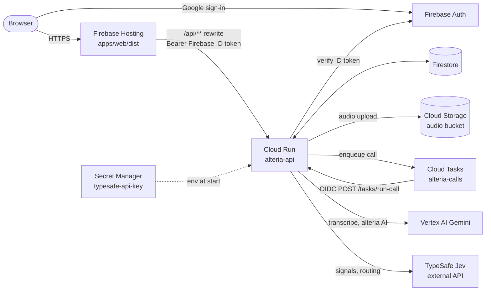

# Deploying aftercall to Google Cloud

API on **Cloud Run** (`alteria-api`, `asia-south1`), web on **Firebase Hosting**, everything else managed by Google.
`./deploy.sh` does it all and is safe to re-run.

## Architecture



| Piece | Name | Notes |
|---|---|---|
| Cloud Run service | `alteria-api` | public URL; `/tasks/*` accepts only the Cloud Tasks OIDC token |
| Runtime service account | `alteria-api@PROJECT` | datastore.user, cloudtasks.enqueuer, aiplatform.user, objectAdmin on the bucket, accessor on the secret, serviceAccountUser on `alteria-tasks` (the Cloud Tasks service agent gets it too) |
| Tasks invoker | `alteria-tasks@PROJECT` | run.invoker on the service; signs the OIDC token |
| Queue | `alteria-calls` | 5 attempts, 10s to 300s backoff, 5 dispatches/s, 10 concurrent |
| Bucket | `PROJECT-alteria-audio` | private, uniform access |
| Secret | `typesafe-api-key` | mounted as `TYPESAFE_API_KEY` |

## Prerequisites

1. A Google Cloud project with **billing enabled** (free tiers cover a demo; billing must still be on).
2. `gcloud` (signed in: `gcloud auth login`) and the `firebase` CLI (`npm i -g firebase-tools`, then `firebase login`). Node 20+ and npm for the web build. Docker is not needed: Cloud Build builds the image.
3. **Firebase linked to the project**: Firebase console, Add project, pick the existing Google Cloud project.
4. **Firebase Auth**: Build, Authentication, Get started, Sign-in method, enable **Google**.
5. **Authorized domains** (Authentication, Settings): `PROJECT.web.app` and `PROJECT.firebaseapp.com` are there by default; add any custom domain.
6. A **web app** in Firebase (Project settings, Your apps, Web). Copy `apiKey`, `authDomain`, `appId`. The Firebase web `apiKey` is a public identifier, not a secret.
7. Your **TypeSafe Jev API key** (the script prompts for it once and stores it in Secret Manager).
8. Your account needs Owner (or Editor plus Project IAM Admin) on the project, since the script binds IAM roles.

## One-time setup

Put the web config in `.env.deploy` (git-ignored) or export it:

```bash
VITE_FIREBASE_API_KEY=...
VITE_FIREBASE_AUTH_DOMAIN=PROJECT.firebaseapp.com
VITE_FIREBASE_APP_ID=...
```

Set the project id in `.firebaserc` (replace `your-gcp-project-id`) or leave it; `deploy.sh` passes `--project`.

## Deploy

```bash
PROJECT=my-project ./deploy.sh --dry-run   # read the plan first
PROJECT=my-project ./deploy.sh
```

Optional: `REGION` (default `asia-south1`), `BUCKET`, `JEV_MODEL`, `VITE_APP_HOST`.

What it does, in order: enable APIs, Firestore (native) if missing, bucket, queue (created or re-tuned), the two service accounts and roles, the secret (prompts if empty), `gcloud run deploy --source apps/backend`, a second pass setting `TASK_SERVICE_URL` to the service's own URL, web build, `firebase deploy --only hosting,firestore:rules,firestore:indexes`. It prints the API and web URLs at the end.

Cloud Run env vars set: `STORE_BACKEND=firestore`, `GCP_PROJECT`, `GOOGLE_CLOUD_PROJECT`, `GOOGLE_GENAI_USE_VERTEXAI=true`, `GCS_BUCKET`, `CLOUD_TASKS_QUEUE`, `CLOUD_TASKS_LOCATION`, `TASK_SERVICE_URL`, `TASK_INVOKER_EMAIL`, `FIREBASE_PROJECT_ID`, `JEV_MODEL`. Secret: `TYPESAFE_API_KEY`.

The first deploy of a Firestore-backed API may need composite indexes. A query that needs one fails with a link in the logs; add it to `firestore.indexes.json` and re-run.

## Verify

```bash
curl -s "$(gcloud run services describe alteria-api --region asia-south1 --project PROJECT --format 'value(status.url)')/health"
```

Then open `https://PROJECT.web.app`, sign in with Google, analyse a sample call, and watch it finish (Cloud Tasks, then Jev). Watch logs for 15 minutes.

## Logs

```bash
gcloud run services logs read alteria-api --region asia-south1 --project PROJECT --limit 100
gcloud run services logs tail alteria-api --region asia-south1 --project PROJECT
gcloud logging read 'resource.type="cloud_tasks_queue"' --project PROJECT --limit 20   # task dispatch failures
```

Console: Cloud Run, alteria-api, Logs. Stuck calls: Cloud Tasks, `alteria-calls`.

## Rollback

API (instant, no rebuild):

```bash
gcloud run revisions list --service alteria-api --region asia-south1 --project PROJECT
gcloud run services update-traffic alteria-api --to-revisions REVISION=100 --region asia-south1 --project PROJECT
```

Web: Firebase console, Hosting, Release history, Rollback on the previous release (or `firebase hosting:rollback --project PROJECT`).

Rules: redeploy the previous `firestore.rules` from git. A bad queue config is fixed by re-running `./deploy.sh`.

## Troubleshooting

| Symptom | Check |
|---|---|
| `/api/*` returns 404 from Hosting | Hosting keeps the `/api` prefix, so the backend must accept it |
| `/api/*` returns 403 | the service must allow unauthenticated invocation (`--allow-unauthenticated`); an org policy on `allUsers` blocks it |
| Calls stay queued | `TASK_SERVICE_URL` set? `alteria-tasks` has run.invoker? Look at the queue's failed attempts |
| Gemini 403/404 | `aiplatform.googleapis.com` enabled; model id and `GEMINI_LOCATION` valid for the project |
| Sign-in popup blocked or "unauthorized domain" | add the domain under Authentication, Settings, Authorized domains |

## Limits

`asia-south1` is supported for Hosting to Cloud Run rewrites. Hosting cuts a request off at 60 seconds and Cloud Run caps HTTP/1 request bodies at 32 MiB, so long work (audio transcription) runs asynchronously in Cloud Tasks; the service has a 900 s request timeout and 1 GiB memory for those task requests.

The service is public (`--allow-unauthenticated`) because browsers and Hosting call it; `/tasks/*` is protected by the app verifying the Cloud Tasks OIDC token (audience `TASK_SERVICE_URL`).

## Approximate cost

For a demo, close to zero, inside free tiers (check current pricing):

| Service | Free tier | Expected demo use |
|---|---|---|
| Cloud Run | 2M requests, 360k vCPU-s, 180k GiB-s a month | within free; scales to zero |
| Firestore | 1 GiB, 50k reads, 20k writes a day | within free |
| Cloud Tasks | 1M operations a month | within free |
| Cloud Storage | 5 GB (US regions only; Mumbai bills pennies) | cents |
| Secret Manager | 6 active versions | within free |
| Firebase Hosting | 10 GB storage, 360 MB/day transfer | within free |
| Cloud Build / Artifact Registry | 2,500 build-min (Cloud Build free), 0.5 GB registry | a few cents after 0.5 GB |
| Vertex AI Gemini | none | pay per token: a few hundred transcripts and analyses is single-digit dollars |
| TypeSafe Jev | external | billed by TypeSafe |

Expect Gemini and Jev to be the only real spend. To stop all charges, delete the project.
